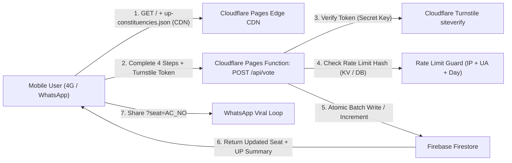

# UP Vidhan Sabha Public Opinion Survey — Database & Data Flow Architecture

## 1. Core Design Goals
- **Sub-1s load on rural 4G & WhatsApp/Facebook in-app browsers:** Zero runtime framework overhead; static HTML/CSS/Vanilla JS + pre-bundled gzipped 75-district / 403-seat JSON (~7 KB compressed).
- **High-traffic free-tier resilience (Firebase + Cloudflare Pages):** Client reads **only 2 aggregate documents** (`up_summary` + selected `seat`), never querying raw vote collections.
- **Anti-spam without login friction:** `localStorage` vote guard + invisible/managed **Cloudflare Turnstile** verified server-side + privacy-preserving salted IP/UA rate limiting.
- **Strict neutrality:** Non-partisan palette, randomized primary option order, mandatory *Undecided* and *NOTA* choices, and persistent independent survey disclaimer.

---

## 2. End-to-End Request & Data Flow



---

## 3. Firestore Data Model (Pre-Aggregated Pattern)

### A. `aggregates/up_summary` (1 Document — State-Wide Totals)
```json
{
  "totalVotes": 14820,
  "options": {
    "opt_a": 3210,
    "opt_b": 3105,
    "opt_c": 2840,
    "opt_d": 1950,
    "other_ind": 1120,
    "undecided": 1985,
    "nota": 610
  },
  "issues": {
    "rozgar": 4210,
    "mehangai": 3190,
    "sadak_bijli": 2110,
    "shiksha": 1680,
    "swasthya": 1240,
    "kanoon": 1350,
    "kisan": 1040
  },
  "ages": {
    "18-25": 4910,
    "26-40": 5620,
    "41-60": 2710,
    "60+": 940,
    "skipped": 640
  },
  "updatedAt": "2026-11-26T07:15:00Z"
}
```

### B. `aggregates/seats/by_id/{acNo}` (403 Documents — Seat-Level Totals)
Document ID is zero-padded or integer AC number (`"1"` through `"403"`, e.g. `"175"` for Lucknow Cantt).
```json
{
  "acNo": 175,
  "districtId": "lucknow",
  "totalVotes": 142,
  "options": { "...": 0 },
  "issues": { "...": 0 },
  "ages": { "...": 0 },
  "updatedAt": "2026-11-26T07:15:00Z"
}
```

> **Scale Note (Hot-Spot Protection):** Standard Firestore documents sustain ~1 write/sec continuously. If a single seat or `up_summary` gets viral traffic (>50 votes/sec), switch `up_summary` to **10 distributed shards** (`aggregates/up_shards/s/0`..`9`) and sum all 10 docs in `/api/results` cached for 15–30 seconds at Cloudflare Edge (`Cache-Control: s-maxage=20`). That scales to thousands of votes/sec while costing almost zero Firestore reads.

### C. `votes/{voteId}` (Write-Only Anonymized Audit Log)
Never read by public clients; used strictly for deduplication checks or offline audit exports.
```json
{
  "acNo": 175,
  "districtId": "lucknow",
  "issueId": "rozgar",
  "optionId": "undecided",
  "ageGroup": "26-40",
  "fingerprintHash": "sha256(ip + ua + daily_salt)",
  "createdAt": "2026-11-26T07:15:00Z"
}
```

### D. Firestore Security Rules
Clients never write directly to Firestore. Only the Cloudflare Pages Function (using a restricted Firebase Service Account) writes after Turnstile & rate-limit checks.
```text
rules_version = '2';
service cloud.firestore {
  match /databases/{database}/documents {
    match /aggregates/{document=**} {
      allow read: if true;
      allow write: if false;
    }
    match /votes/{voteId} {
      allow read, write: if false;
    }
  }
}
```

---

## 4. API Contract (Cloudflare Pages Functions)

| Endpoint | Method | Purpose | Edge Cache / Protection |
| :--- | :--- | :--- | :--- |
| `/api/vote` | `POST` | Validates payload (`acNo` 1–403, valid IDs), verifies Cloudflare Turnstile token, enforces IP+UA rate limit, performs atomic increment on `up_summary` & `seats/{acNo}`, returns fresh aggregates. | No cache; Turnstile + Rate Limit |
| `/api/results?ac=175` | `GET` | Returns `up_summary` and `seats/{acNo}` for repeat visitors or shared-link viewers. | `Cache-Control: public, s-maxage=15, stale-while-revalidate=30` |

---

## 5. Dataset Architecture (`data/up-constituencies.json`)
- **Source:** Compiled from ECI / CEO Uttar Pradesh constituency mappings (75 districts, 403 assembly seats AC #1 to #403, reservation status `SC` / `ST`, bilingual `en` & `hi` names).
- **Size:** ~24 KB raw / ~7 KB gzipped static asset cached at Cloudflare CDN edge.
- **UX benefit:** Instant local substring matching in both Devanagari (`लखनऊ`) and Latin (`lucknow` or `175`) with zero network round-trips.
